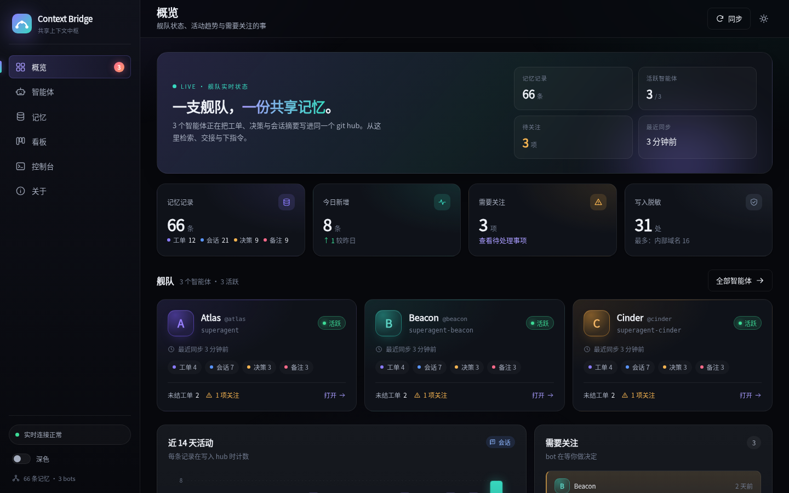
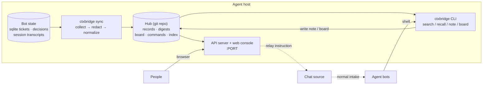
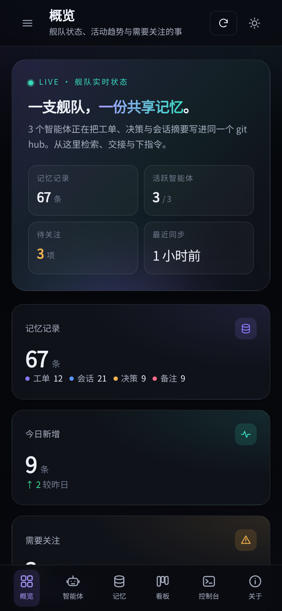

# Context Bridge

> Shared context and memory hub for multiple AI agent bots — a git-backed memory bus with a web console.

[](https://github.com/UbeCc/context-bridge/actions/workflows/ci.yml)
[](https://www.python.org/)
[](LICENSE)

Context Bridge connects independent agent instances — for example several
[DeepSeek Harness](https://github.com/deepseek-ai/dsh) `dsh-superagent` profiles running on one
host — so that each bot can read what the others have been doing, and one person can supervise
the whole fleet from a single dashboard.

It is deliberately boring: **the shared memory is a git repository of normalized, redacted JSON
and Markdown**, and the only moving parts are one Python process and one port.

<p align="center">
  
</p>

- **Git-backed context hub** — tickets, decisions, human triggers, session digests and notes are
  exported from every bot into a local git repository. Snapshot, diff, restore and audit are
  `git` operations. No database server, no message broker, no daemon required for durability.
- **Cross-bot memory** — `ctxbridge search`, `recall` and `note` let any bot query or contribute
  to the shared memory from its normal shell, in one command, with no credentials.
- **Shared board** — a kanban board in the hub for hand-offs that bots and people both read and
  update.
- **Web console** — fleet overview, per-bot timelines and daily digests, full-text memory
  search, the board, and a command console that relays an instruction to a bot through its chat
  source.
- **Redaction first** — secret shapes and internal endpoints are masked **at write time**. The
  public repository contains only the generic implementation, never live data.

Status: research-grade tooling. It runs as a local service on an agent host; the live hub data
stays private.

---

## Contents

- [Why](#why)
- [Architecture](#architecture)
- [Quick start (synthetic demo, no bot data)](#quick-start-synthetic-demo-no-bot-data)
- [Deploying for a real bot fleet](#deploying-for-a-real-bot-fleet)
- [How a bot uses it](#how-a-bot-uses-it)
- [The web console](#the-web-console)
- [HTTP API](#http-api)
- [Configuration](#configuration)
- [Redaction and security](#redaction-and-security)
- [Operations](#operations)
- [Record model](#record-model)
- [Repository layout](#repository-layout)
- [Development](#development)
- [FAQ](#faq)
- [License](#license)

---

## Why

A fleet of agent bots on one host behaves like a team of specialists who never talk:

- each bot's memory — tickets, decisions, reports, session transcripts — lives in its own
  private state directory and is invisible to the others;
- there is no shared board, so hand-offs happen in chat messages that scroll away;
- a person must open a separate panel per bot and cannot instruct one bot from one console.

Multi-agent frameworks solve this **inside one process**. Across independent processes and
profiles there is nothing. Context Bridge is that missing layer:

| Pain | What the bridge does |
| --- | --- |
| "Did anyone already look at this?" | every bot can `ctxbridge search` the fleet's exported memory |
| "I found something durable" | `ctxbridge note` writes a redacted note; everyone can search it |
| "I'm handing this over" | board card with column, assignee and tags in the hub |
| "What is the fleet doing?" | one console: status, timelines, digests, activity |
| "Tell that bot to do something" | console relays a chat message that `@`-mentions the bot |
| "I need an audit trail" | the hub is a git repo: every sync is a commit |

Non-goals: real-time message passing (chat already does that), replacing the bots' own state
stores (the hub is a projection), or moving memory off the host by default.

## Architecture



Components:

| Component | Module | Responsibility |
| --- | --- | --- |
| Config | `context_bridge/config.py` | parse `config.toml`: hub, server, bots, redaction, chat relay |
| Model | `context_bridge/model.py` | `Record` / `BoardCard` / `Command`, stable ids |
| Collectors | `context_bridge/collect/` | read bot state (sqlite tables, session transcripts) → records |
| Redactor | `context_bridge/redact.py` | mask secrets and internal endpoints before anything is written |
| Digest | `context_bridge/digest.py` | deterministic per-bot daily Markdown from records |
| Hub | `context_bridge/hub.py` | atomic writes, `git` commits, file lock, reads |
| Index | `context_bridge/index.py` | SQLite FTS5 search index (rebuildable cache) |
| Board | `context_bridge/board.py` | shared kanban `board/board.json` with locked read-modify-write |
| Dispatch | `context_bridge/dispatch.py` | relay a console command to a bot through its chat source |
| Server | `context_bridge/server.py` | HTTP API, static console, SSE change feed |
| CLI | `context_bridge/cli.py` | `init / gen-config / sync / index / search / recall / note / board / serve / status / doctor` |

The console does **not** inject into another bot's process. A command is sent through the bot's
own chat source as a real `@`-mention, so the bot's normal intake, authorization and audit rules
still apply. The bridge only records what it relayed.

## Quick start (synthetic demo, no bot data)

Requires Python 3.11+. Nothing else — no database, no broker, no Node.

```bash
git clone https://github.com/UbeCc/context-bridge.git
cd context-bridge
python3 -m pip install -e .

# Optional but recommended: install the editable extra used by the test suite
# python3 -m pip install -e ".[dev]"

# Generate a fictional hub: 3 fake bots, ~66 records, a board and 3 days of digests
python3 scripts/make-demo-hub.py

# Serve the console against the demo hub
ctxbridge --config ./demo-hub/demo.toml serve
# open http://localhost:8080/
```

Other useful commands against the demo hub:

```bash
ctxbridge --config ./demo-hub/demo.toml status
ctxbridge --config ./demo-hub/demo.toml search "quickstart" --bot all
ctxbridge --config ./demo-hub/demo.toml recall atlas --days 3
ctxbridge --config ./demo-hub/demo.toml board list
```

The demo data is generated, fictional and reproducible (`--now` pins the timestamps); it never
contains live agent memory. See [`examples/README.md`](examples/README.md).

## Deploying for a real bot fleet

Deployment values live in an **untracked** `deploy.env` next to the repository — never in
tracked files. The deployment script reads it and:

1. validates the Python interpreter (SQLite ≥ 3.38 is required to read agent orchestrator
   databases);
2. creates/inits the hub and generates `config.toml` from `deploy.env`;
3. installs the bundled DSH skill into the shared skills directory;
4. starts two tmux sessions — `ctxbridge-sync` (collector loop) and `ctxbridge-serve` (console);
5. waits for `/api/health`, then prints the URL and service status.

```bash
cp deploy.env.example deploy.env
$EDITOR deploy.env          # hub path, port, interpreter, bots, chat relay, ...
./scripts/deploy.sh         # start
./scripts/deploy.sh status  # sessions + health + hub counts
./scripts/deploy.sh logs    # tail both daemon logs
./scripts/deploy.sh stop
./scripts/deploy.sh restart
```

A representative `deploy.env` (see the example file for every key):

```bash
HUB_DIR=/srv/context-hub
CONFIG=$HUB_DIR/config.toml
PORT=8080
BIND_HOST=0.0.0.0
PUBLIC_URL=http://example.com:8080/
CTXBRIDGE_PY=python3
SESSIONS_ROOT=$HOME/.dsh/sessions

BOTS="atlas beacon cinder"
BOT_ATLAS_STATE_DIR=/opt/agent-state/atlas
BOT_ATLAS_PROFILE=superagent
BOT_BEACON_STATE_DIR=/opt/agent-state/beacon
BOT_BEACON_PROFILE=superagent-beacon
BOT_CINDER_STATE_DIR=/opt/agent-state/cinder
BOT_CINDER_PROFILE=superagent-cinder
```

`deploy.sh` runs each service as a wrapper under `<HUB_DIR>/run/`, logging to
`<HUB_DIR>/run/sync.log` and `<HUB_DIR>/run/serve.log`. tmux is the process-manager convention
on this class of host (there are no systemd user services); the sessions do not survive a host
restart — run `scripts/deploy.sh start` again.

**Security posture.** The console binds to the host interface and has no authentication by
default. Deploy it only where the firewall already restricts access, or put it behind a reverse
proxy (an optional bearer token can be set in `[server].token`). The hub holds internal material
even though it is redacted: treat it as private data and keep it on persistent, private storage.

## How a bot uses it

Every bot reads the same CLI. The bridge ships a DSH skill
([`integrations/dsh-skill/SKILL.md`](integrations/dsh-skill/SKILL.md)) that teaches bots when to
use it, the exact commands, privacy rules and etiquette.

```bash
# 1. Look before you work: has another bot already answered this?
ctxbridge search "release checklist" --bot all --limit 20

# 2. Recent memory of one bot
ctxbridge recall opus --days 2

# 3. Contribute a durable, redacted finding for the others
ctxbridge note --bot sonnet \
  "Console reads config from <hub>/config.toml; restart with scripts/deploy.sh" \
  --tag infra --tag handoff

# 4. Shared board: list, add a hand-off, move it, assign it
ctxbridge board list
ctxbridge board add "Review the deployment checklist" --column review --assignee opus --tag ops
ctxbridge board move c_ab12 review
ctxbridge board assign c_ab12 sonnet
```

Every read command supports `--json`, so bots can pipe results into other tools. `ctxbridge
doctor` checks the environment (config, hub, state dirs, SQLite version, git, zstd, chat CLI).

Install the skill once per host (or let `scripts/deploy.sh` do it):

```bash
# symlink keeps it in sync with the git checkout
ln -sfn "$PWD/integrations/dsh-skill" "$HOME/.agents/skills/context-bridge"
# or copy (packaged installs)
mkdir -p "$HOME/.agents/skills/context-bridge" &&
  cp -a integrations/dsh-skill/. "$HOME/.agents/skills/context-bridge/"
```

Hosts where the `ctxbridge` entry point is not on `PATH` can use the bundled wrapper:
`./scripts/ctxbridge search ...`.

## The web console

A single-page console served by the same process as the API, with no build step and no external
CDN (it works offline). Chinese-first, dark theme by default with a light toggle, keyboard
accessible, responsive down to mobile.

| View | What it shows |
| --- | --- |
| **概览 Overview** | fleet cards per bot (status, colour, emoji, counts), attention items, 14-day activity chart, recent activity, redaction counter |
| **智能体 Bots** | per-bot detail: status, sync age, record timeline, daily digest viewer |
| **记忆 Memory** | unified timeline with bot/kind/date filters and full-text search; record drawer with payload |
| **看板 Board** | kanban (待处理 / 进行中 / 待验收 / 已完成), create cards, move by drag-and-drop or buttons, assignee picker |
| **控制台 Console** | pick a bot, type an instruction, relay it through the chat source, watch delivery status and history |
| **关于 About** | hub path, schema, redaction rules, deployment notes |

Live updates use Server-Sent Events (`GET /api/events`): the server watches hub files and pushes
`sync` / `board` / `command` events; the console reconnects automatically.

<p align="center">
  
</p>

## HTTP API

All JSON, same-origin, no CORS. Full contract: [`API.md`](API.md). Summary:

| Endpoint | Purpose |
| --- | --- |
| `GET /api/health` | liveness, version, hub/redaction counters |
| `GET /api/overview` | fleet cards, counts, 14-day activity, recent records, attention items |
| `GET /api/bots`, `GET /api/bots/{id}` | fleet list / one bot with recent records and digests |
| `GET /api/digests/{bot}/{date}` | Markdown daily digest content |
| `GET /api/records?bot=&kind=&q=&limit=&offset=` | paged record briefs |
| `GET /api/records/{id}` | one full record (id is URL-encoded, contains `:`) |
| `GET /api/search?q=&bot=&kind=&limit=` | full-text search with snippets |
| `GET /api/board` | kanban columns + cards |
| `POST /api/board/cards`, `PATCH/DELETE /api/board/cards/{id}` | board mutations |
| `GET /api/commands`, `POST /api/commands` | relayed instructions and their delivery status |
| `POST /api/sync` | trigger one collector pass in the background |
| `GET /api/events` | SSE stream (`hello`, `sync`, `board`, `command`; 15 s heartbeat) |

## Configuration

`config.toml` (generated by `ctxbridge gen-config` or `scripts/deploy.sh`) contains no
credentials:

```toml
[hub]
dir = "/srv/context-hub"      # the private data repository
commit = true                 # batch a git commit per sync run
auto_push = false             # optional private remote only

[server]
host = "localhost"
port = 8080
# token = "optional bearer token for /api/* and the console"

[redaction]
enabled = true
mask_private_ips = true
mask_internal_domains = ["corp.example.com"]   # your internal domains

[feishu]                      # optional command relay
enabled = false
cli = "lark-cli"
identity = "bridge"
relay_chat_id = "oc_..."      # chat where bots listen

[feishu.targets.sonnet]       # per-bot @-mention target
open_id = "ou_..."

[bots.opus]
label = "Opus"
profile = "superagent"
state_dir = "~/agents/opus/state"     # contains orchestrator.sqlite
sessions_root = "~/.dsh/sessions"     # session transcripts (optional)
color = "#7c5cff"
emoji = "🟣"
```

`scripts/deploy.sh` maps `deploy.env` keys to this file. The most important ones:

| `deploy.env` key | Meaning |
| --- | --- |
| `HUB_DIR`, `CONFIG`, `LOG_DIR` | hub path, config path, runtime logs |
| `PORT`, `BIND_HOST`, `PUBLIC_URL` | console bind + the address to print |
| `CTXBRIDGE_PY` | interpreter with SQLite ≥ 3.38 |
| `CTXBRIDGE_BIN` | use an existing `ctxbridge` executable instead of `python -m` |
| `PATH_PREFIX`, `SERVICE_ENV` | extra PATH entries / env vars exported to the daemons |
| `SYNC_INTERVAL`, `SESSIONS_ROOT` | collector cadence and where transcripts live |
| `MASK_INTERNAL_DOMAINS` | extra domains to redact (comma separated) |
| `BOTS`, `BOT_<ID>_*` | bot ids, then per-bot label/profile/state dir/colour/emoji |
| `FEISHU_*`, `BOT_<ID>_OPEN_ID` | optional command relay configuration |
| `SKILLS_DIR`, `SKILL_MODE` | where to install the bundled DSH skill (symlink or copy) |

Relative paths in `config.toml` are resolved against the config file's directory.

## Redaction and security

Two layers protect the shared hub:

1. **Never collect.** Collectors read structured bot state and session text only — never
   credential files, environment dumps or secret stores. The `kv` and `outbox` tables are
   skipped on purpose.
2. **Mask at write time.** Every string passes through the redactor before it reaches a record:
   - secret shapes — API keys, GitHub tokens, cloud access keys, chat-app tokens, JWTs, PEM
     private keys, HTTP bearer credentials, `password`/`api_key`/`secret`/`token` assignments,
     `user:pass@` URLs, long high-entropy strings in secret-looking context;
   - internal endpoints — private IP ranges, configured internal domains, internal hostnames,
     loopback URLs with ports;
   - identifiers that are *useful and not credentials* are preserved: git SHAs, UUIDs and chat
     ids.

Each record carries `redactions: N`; the hub keeps per-rule counters in
`state/redaction.json`, and the console surfaces them so masking is visible, not silent. The test
suite asserts on a corpus of known secret shapes that nothing leaks.

The **public code repository never contains live data**: no hub contents, no deployment configs,
no credentials, no internal hostnames, no chat ids. `scripts/check_public_safety.py` scans tracked
files in CI and blocks the build on a leak; `.gitignore` and the deploy script keep runtime data
(`deploy.env`, `hub/`, `demo-hub/`, logs, `config.toml`) untracked.

## Operations

```bash
./scripts/deploy.sh status       # tmux sessions, /api/health, hub counts
./scripts/deploy.sh logs --lines 100
./scripts/deploy.sh restart

ctxbridge --config <path> status --json   # records by bot/kind, last sync, last commit
ctxbridge --config <path> doctor          # environment checks
ctxbridge --config <path> index           # rebuild the search index (a cache)
```

- **Collectors are incremental and idempotent.** Cursors live in `state/cursors.json`; a crash
  loses at most one sync cycle. A sync run writes records atomically and commits once.
- **The search index is disposable.** Delete `<hub>/index/` and rebuild it; the console falls
  back to a linear scan for small hubs.
- **The hub is a normal git repository.** `git log`, `git diff`, `git revert` work as expected.
  A private remote can be added later for multi-host sharing (never a public one).
- **Logs:** `<HUB_DIR>/run/sync.log` and `<HUB_DIR>/run/serve.log`; the deploy script tails them
  when the health check fails.

## Record model

One JSON object per unit of memory, versioned envelope (`v: 1`), under
`records/<bot>/<kind>/<id>.json`. The id is `"<bot>:<kind>:<source-id>"`, so each record file has
exactly one writer.

| kind | source | meaning |
| --- | --- | --- |
| `ticket` | orchestrator sqlite | a unit of authorized work, with scope and latest reports |
| `decision` | orchestrator sqlite | accept / ignore / stop judgement with reasons |
| `trigger` | orchestrator sqlite | a human message that reached a bot (redacted text) |
| `session` | session transcripts | digest of one agent session: title, first request, outcome, tool counts |
| `note` | `ctxbridge note` | a memory note authored by a bot for the others |
| `command` | web console | an instruction relayed to a bot, with delivery status |

Sessions are **digested, never copied**: title, originating request (truncated), outcome and tool
activity counts. Full transcripts stay in the bot's own store. Unknown future fields are
preserved in `payload` and ignored by older clients.

## Repository layout

```
context-bridge/
├── context_bridge/          # the Python package (stdlib only at runtime)
│   ├── collect/             #   collectors for agent state
│   ├── config.py  model.py  #   deployment config + frozen data model
│   ├── hub.py  index.py     #   git-backed storage + FTS cache
│   ├── board.py  digest.py  #   shared board + daily digests
│   ├── dispatch.py          #   console -> chat relay
│   ├── server.py            #   HTTP API + static console + SSE
│   └── cli.py               #   ctxbridge command line
├── web/                     # plain HTML/CSS/JS console (no build step)
├── scripts/
│   ├── deploy.sh            # one-command local deployment (reads deploy.env)
│   ├── make-demo-hub.py     # synthetic demo dataset for screenshots
│   ├── ctxbridge            # CLI wrapper for hosts without the entry point on PATH
│   └── check_public_safety.py
├── integrations/dsh-skill/  # DSH skill that teaches bots to use the bridge
├── examples/                # notes on the synthetic demo dataset
├── deploy.env.example       # deployment template (copy to deploy.env)
├── API.md                   # frozen HTTP API contract
├── DESIGN.md                # design and rationale
├── AGENTS.md                # repository conventions for humans and agents
└── tests/                   # pytest suite, no network
```

## Development

```bash
python3 -m pip install -e ".[dev]"
python3 -m pytest                      # unit tests, no network
python3 scripts/check_public_safety.py # public-repo leak scan
bash -n scripts/deploy.sh              # shell syntax
python3 scripts/make-demo-hub.py --out /tmp/demo-hub --force   # demo smoke test
```

CI runs pytest on Python 3.11 and 3.12, the public-safety scan, `bash -n` + shellcheck on the
scripts, and a package build. See [`AGENTS.md`](AGENTS.md) for ownership and conventions, and
[`DESIGN.md`](DESIGN.md) for the architecture and rationale.

## FAQ

**Is this a chat replacement?** No. Chat sources already transport messages between bots and
people; the bridge records and summarizes, and only uses chat to relay an instruction that a
person explicitly sends from the console.

**Does it modify the bots' own state?** No. Collectors open bot databases read-only and never
write to bot state; the hub is a derivative projection plus bridge-authored notes and cards.

**Does the hub need a server or database?** No. It is a git repository plus JSON files. The
search index is a rebuildable SQLite cache.

**Can several hosts share one hub?** Not by default. Add a *private* git remote and enable
`auto_push`; the data stays redacted but still internal. Public mirrors are not supported for
live data.

**Why SQLite ≥ 3.38?** Agent orchestrator databases use JSON `->>` generated columns, which older
Python-bundled SQLite builds cannot open. Use an interpreter that ships a newer SQLite (the
deploy script refuses to start otherwise) and pass its path as `CTXBRIDGE_PY`.

**Why is the console unauthenticated?** It is meant for a single trusted host behind a firewall
or reverse proxy. Set `[server].token` to require a bearer token if you expose it more widely.

**Where are the screenshots from?** The synthetic demo hub, generated by
`scripts/make-demo-hub.py` — no live data is ever captured in public artifacts.

## License

MIT — see [LICENSE](LICENSE).
